十月中旬苹果动了 Apple ID 登录的校验逻辑，侧载圈子里一片 -80045，我本来只想把 SideStore 重装一遍，结果一路从登录报错排查到免 JIT 签名，折腾了好几个晚上。

好在每个坑的成因都挺具体，配对文件、Anisette 身份、证书、App Group 里焊死的团队 ID，看着散，其实是三条一致性没对上：身份要一致，协议要单一，账号要统一，理清这三条，剩下的基本就是复制粘贴。

我的环境是 iPhone、iOS 27.2、免费 Apple ID，只有一台 Windows 电脑做初始安装。文中 Apple ID、团队 ID、配对文件名都做过脱敏，你换成自己的环境时数值肯定不一样。

## 先认工具

这套组合里每个东西都有明确分工，先认出谁管什么，后面报错才知道该往哪看。

| 工具 | 作用 |
|---|---|
| SideStore | 无线侧载工具，用 Apple ID 证书给应用签名，免费证书 7 天到期需要刷新续期 |
| LiveContainer | 应用容器，在自身内部运行 IPA，支持免 JIT 模式（借 SideStore 的证书签名） |
| 嵌合体 | LiveContainer 与 SideStore 打包成一个 IPA，只占 1 个应用槽 |
| iloader | 电脑端侧载工具，负责把 IPA 装进手机 |
| idevice_pair | 生成 SideStore 需要的配对文件（`.mobiledevicepairing`） |
| LocalDevVPN | App Store 上的免费 VPN 应用，为无线刷新提供本地隧道 |
| Anisette | 苹果的设备身份验证数据，登录 Apple ID 时必须携带 |

免费账号有三条红线，后面每个坑几乎都能追到这三条上：证书槽位只有 2 到 3 个，占满就装不了新东西，App ID 每周 10 个，每个扩展也算一个，证书 7 天过期，过期不续整个应用都打不开。想清楚这三条，很多「莫名其妙的失败」就有解释了。

## 坑 1：登录直接 -80045

输完 Apple ID 和密码，屏幕上直接甩出一个 `Failed to Sign In: This action cannot be completed at this time. (-80045)`，这个报错最坑的地方是它出现在密码校验之前，苹果在身份验证那一步就把请求拒了，所以改密码、换网络、重装 SideStore 全都不管用，白折腾半天。

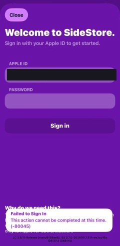

原因在两条信息对不上。SideStore 登录时要递给苹果两样东西，一份自称身份的 headers（Client Info 与 User Agent），一份 Anisette 服务生成的设备验证数据，2026 年 10 月 12 日起苹果开始校验这两者是否一致，默认配置里 headers 自称是一台跑 macOS 的 Mac，Anisette 数据却是 iPhone 上生成的，两边对不上，请求就被驳回。

界面上的坑藏在颜色里，那两个框的内容是白字，看着像空着，其实有值，「我什么都没填」基本是错觉，真正要换掉的是这份默认身份。

<div style="display: flex; gap: 16px; align-items: flex-start; flex-wrap: wrap;">

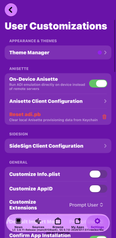

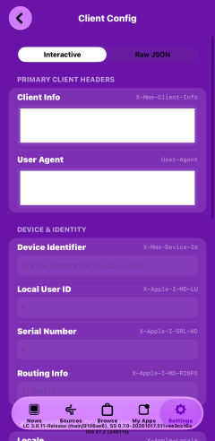

</div>

修复有两条路，先看自己装的是哪个版本。

路线 A 是升级 Nightly，SideStore 官方在 10 月 26 日合并了登录修复（PR #1683），会把客户端身份硬编码成苹果目前认可的 Windows 加 iTunes 组合，并优先使用 Windows ADI 服务器，正是下面那些手动步骤在做的事，装 10 月 26 日之后的 Nightly，-80045 大概率直接消失。

路线 B 是手动改身份，适合暂时不想升级或者升级后仍然报错的情况，顺序不能跳：

1. SideStore 设置里滑到底进 **Anisette Servers**，选 **SideStore (New)**（社区反馈里 Jkcoxson 也是备选），并关闭 **Enable Auto Rotation**，否则它会自动切回旧服务器
2. 回到 **User Customizations**，关闭 **On-Device Anisette**
3. 进 **Anisette Client Configuration**，切到 **Raw JSON** 标签，把旧的覆盖配置清空，不清掉的话下一步会被它挡住
4. 回到 **Interactive** 标签点 **Fetch**，从服务器同步一份苹果认可的身份，再点 **Save as Overrides**
5. 返回点 **Reset adi.pb**，这一步会清掉本地的 Anisette 缓存，不会动已安装的应用
6. 从后台把 SideStore 完全划掉，重新打开，输账号密码

如果版本里没有 Fetch 按钮，就在 Interactive 页手动填这两行：

```text
Client Info : <PC> <Windows;6.2(0,0);9200> <com.apple.AuthKit/1 (com.apple.iTunes/12.12.4.1)>
User Agent  : akd/1.0 CFNetwork/808.1.4
```

改完同样要 Save as Overrides、Reset adi.pb、杀后台重开。

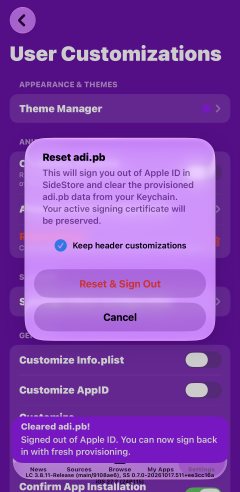

> [!IMPORTANT]
> 核心原则只有一句：headers 自称什么身份，Anisette 数据就必须是什么身份，所有步骤都是在保证这两边一致。

重新登录有两个细节值得留意，Sign in 只点一次，连点会触发苹果的风控，越急越登不上，如果别的苹果设备弹出 6 位验证码，记得先记下来再输，这个码只显示一次。

卡在 503 不是失败。走到这一步、验证码也输完了的话，界面会弹出一段没被解析的 HTML，里面写着 `503 Service Temporarily Unavailable` 和 `Apple`，说明身份验证已经过了，是苹果自己的登录服务器在限流，那两周大量用户集中重试，风控很紧，这时候唯一正确的操作是停手，等 30 到 60 分钟再试一次，期间可以顺手在 Safari 里登一下 appleid.apple.com，确认账号本身没有「需要验证」或条款更新的提示。

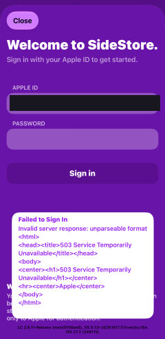

## 坑 2：配对文件格式不明确

导入配对文件时提示 `The pairing file format is ambiguous`，原因是文件里同时装了 Remote Pairing 和 Lockdown 两套凭证，而 2026 年 9 月 20 日之后的 Nightly 只接受单一协议，更麻烦的是 iOS 27 改了 Lockdown 的配对格式，设备上根本没法用，SideStore 实际只需要 Remote Pairing 那一份。

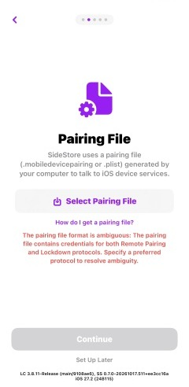

解法是重新生成一个只含 Remote Pairing 的文件：

1. 电脑上装 **idevice_pair**，iloader 的配对功能当时有 bug，社区建议换用这个
2. iPhone 解锁、保持亮屏，连 USB 并信任电脑，工具里显示 device locked 时 Create 按钮是灰的
3. 协议只选 **Remote pairing**，点 Create，选 Lockdown 虽然也能导入，但之后刷新应用必报 Broken Pipe
4. 导出的 `.mobiledevicepairing` 传到手机（AirDrop 最快），在 SideStore 里重新选中

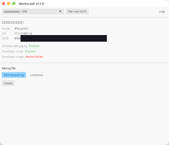

不想用电脑的话，StikDebug 或 StikPair 可以直接在设备上生成，再分享给 SideStore。

> [!NOTE]
> 配对文件长期有效，除非在手机上做了「还原位置与隐私」或重置网络设置，重装 SideStore 时它会保留，不用每次重新生成。

## 坑 3：Revoke Certificates 该不该点

登录成功后 SideStore 会检测这个 Apple ID 名下已有的开发证书，问要不要吊销，这里没有标准答案，取决于那台旧设备还在不在用：还在别的电脑上装过 App 就点 Cancel，吊销了那边签的应用会全部打不开，确定是旧设备、早就不用了就点 Revoke，顺便清出证书名额。

不确定就先 Cancel 往下走，将来装应用时真报「证书数量超限」，再回来处理也不迟。

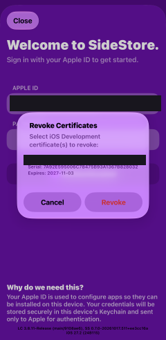

## 坑 4：No wifi interface satisfied

现象很直白，登录都过了，注册设备时弹出 `Device Registration Error`，下面写着 `Network Connection Error: No wifi interface satisfied`，点几次 Retry 结果都一样。

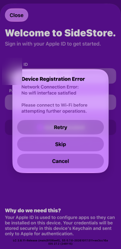

原因是这一步不走蜂窝网络，SideStore 要先连上 LocalDevVPN 建立的本地隧道，再由这条隧道把请求转给苹果，iOS 上隧道绑定的是 Wi-Fi 接口，手机切到 4G 之后这个接口根本不存在，请求还没发出去就被拦下了。

解法很简单，连上任意一个 Wi-Fi（手机热点也算），回弹窗点 Retry，然后保持连接直到 onboarding 走完。

> [!NOTE]
> 这不是一次性的要求，之后每次刷新续期、Resign 自己、注册新设备，都要走这条隧道，打算长期用下去的话，Wi-Fi 是必需品，不是装完就能丢的临时条件。

## 坑 5：Resign 与扩展取舍

吊销或启用新证书之后，手机上的 SideStore 还是用旧证书签的名，所以要立刻用新证书把自己重装一遍，点 **Resign Now** 后会走一遍安装流程，装完 SideStore 自动闪退是正常现象，回桌面重新打开就行，配对文件和 Anisette 配置都会保留。

重装过程中会问扩展怎么办，几个选项其实是在抢那 10 个 App ID 名额：

| 选项 | 代价 | 适合 |
|---|---|---|
| Keep App Extensions (Use Main Profile) | 用主配置保留全部扩展，占 4 个 App ID | 需要 Multitask 多任务窗口 |
| Keep App Extensions (Register App ID for Each Extension) | 每个扩展单独注册，按扩展个数各占一个 | 极少用到，和上一项没有实质区别 |
| Remove App Extensions | 全部删掉，没有小组件和分享菜单入口 | 名额紧张时的默认选择 |
| Choose App Extensions | 自己勾选保留哪几个 | 只想要小组件这类折中场景 |

<div style="display: flex; gap: 16px; align-items: flex-start; flex-wrap: wrap;">

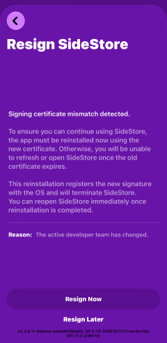

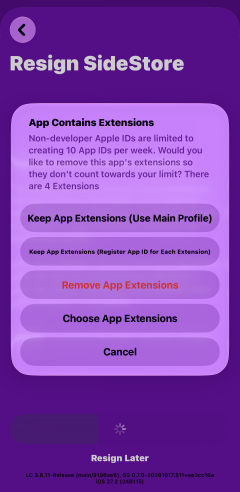

</div>

这些扩展，桌面倒计时小组件也好，分享菜单里「用 SideStore 打开」也好，都是锦上添花，装 IPA、签名、刷新、登录这些核心能力全在主程序里，所以免费账号下我选的是 Remove。

> [!WARNING]
> 老版本 SideStore 有个已知 bug，刷新应用时会把删掉的扩展重新注册回来，再次占用名额，遇到「明明删了扩展怎么又超限」，先更新到最新 Nightly 再操作。

## 坑 6：免 JIT 签名无效，团队 ID 对不上

这是整场折腾里最耗时间的一个，也是我最想写下来的一段。LiveContainer 的免 JIT 诊断页上，「证书团队名」标红，和「预期团队 ID」不一致，容器里签好名的应用一动就提示签名无效。

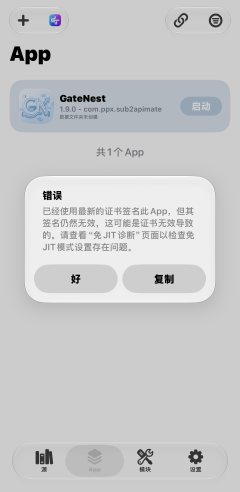

先看这两个值分别是什么。「预期团队 ID」是 LiveContainer 从 SideStore 的 App Group 名字里读出来的，而 App Group 的前缀在安装嵌合体的那一刻就焊死了，「证书团队名」是当前签名证书的真实团队 ID，免 JIT 的原理是用 SideStore 的证书给容器里的应用签名，再塞进这个 App Group 让 iOS 认可，所以两个值必须相等。

我的根因很蠢，嵌合体是用 Apple ID A 装的，配签名时却在 SideStore 里登录了 Apple ID B，团队 ID 跟着账号走，两个账号的团队 ID 永远不可能相等，刷新诊断页刷一万次也没用。

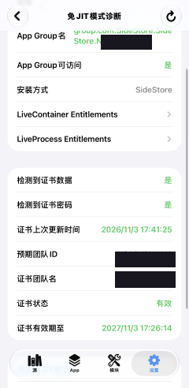

修复的关键是把账号统一回安装嵌合体的那个，Sign Out 弹窗里有两个勾要反着来：

- **取消勾选** Keep signing certificate，现在这份是另一个账号的证书，必须让它作废
- **保留** Keep Anisette data 和 Keep Anisette headers，这是坑 1 好不容易调好的登录配置，弄丢了又要面对 -80045

然后用安装嵌合体的那个账号重新登录，后面的顺序是：

1. 重新登录后大概率会再走一遍证书流程，弹出的旧证书按坑 3 的原则处理
2. Resign SideStore 时扩展照样选 Remove
3. 把 SideStore 和 LiveContainer 都从后台划掉，重开
4. 进 LiveContainer 的免 JIT 诊断，点刷新，确认两个团队 ID 一致、红色变绿
5. 容器里的应用删掉，重新导入 IPA 再签名，旧签名记录里存的是错误团队 ID，不重签修不好

> [!CAUTION]
> 嵌合体的安装账号、SideStore 的签名账号、免 JIT 用的证书，三者必须是同一个 Apple ID，这是这一节唯一需要记住的事。

## 坑 7：My Apps 里出现两条 LiveContainer

如果你先用电脑装了一份、后来又从 SideStore 装了一份，列表里就会有两条记录，「Sideloaded」那条是电脑装的，SideStore 只能观察、不能给它续期，带团队名的那条才是 SideStore 自己装的，可以刷新。

建议只留后者，前者的 7 天一到还得连电脑重来一次，那就白折腾了。

## 进阶：一键启动、多开、自动续期

**一键启动**方面，LiveContainer 里长按应用选「添加到主屏幕」，推荐走 **创建 AppClip**，生成一个描述文件，装完桌面就有原生图标，点开直接启动，另两个选项（复制 `livecontainer://` 链接、保存图标）是给快捷指令自定义图标用的，麻烦得多。

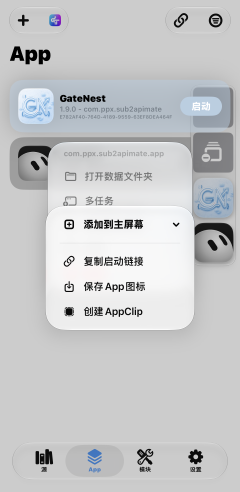

**多开**有两条路：

| 方案 | 做法 | 代价 |
|---|---|---|
| Multitask 多任务窗口 | 长按应用横幅选 Multitask，可缩放、可画中画，多应用同时挂着 | 装 LiveContainer 时必须保留 App Extensions，占 4 个 App ID |
| 多实例 | 设置里「安装另一个 LiveContainer」，生成 IPA 后用 SideStore 装 | 每个实例占一个应用槽，免费账号只有 3 个 |

嵌合体已经占了一个槽，正好还能再装两个实例，跨实例跑同一个应用要先「转换为共享 App」。

**自动续期**这块，免费证书 7 天过期，手动每周点一次迟早会忘，用快捷指令可以跑通全自动，动作顺序是这样：

1. 获取网络详细信息（Wi-Fi 名称）
2. 如果「有任何值」，没连 Wi-Fi 就不往下走
3. 设定 VPN → 连接 **LocalDevVPN**
4. 等待 3 秒
5. 打开 URL `sidestore://`，先把 SideStore 唤到前台，否则刷新动作经常失败
6. 等待 3 秒
7. **Refresh All Apps**，嵌合体这里要用 LiveContainer 提供的刷新动作，SideStore 那个无效
8. 等待 30 秒
9. 设定 VPN → 断开
10. 显示通知「续签完成」

然后在自动化里挂一个「一天中的时间」，运行时选**立即运行**，别选「运行前询问」。

> [!NOTE]
> iOS 的定时不是精确闹钟，锁屏、低电量模式或勿扰时可能延后几十分钟，所以选每天一次比每周一次保险，到期有 7 天缓冲，偶尔漏一天问题不大。

## 维护清单

配好之后日常要盯的东西不多，主要这几条：

- 每周看一眼 My Apps 的倒计时是不是回到 7 DAYS，别只依赖通知
- 记住三条红线：证书 2 到 3 个、App ID 每周 10 个、证书 7 天过期
- 换路由器或网段之后，LocalDevVPN 的地址可能需要重新配置，否则刷新会失败
- 重装 SideStore 或 LiveContainer 之后，证书要重新从 SideStore 导出给 LiveContainer，团队 ID 必须和 App Group 一致（见坑 6）
- 升级优先看 SideStore 的 Nightly，10 月 26 日之后的构建已内置 -80045 的修复

这一路折腾下来，真正难的从来不是某一条命令，而是那三条一致性，身份对上、协议单一、账号统一，任何一处不一致，iOS 都不会告诉你哪里错了，只会丢一个错误码过来。把这三条记住，下次换个设备重来，大概率一个晚上就能搞定。
